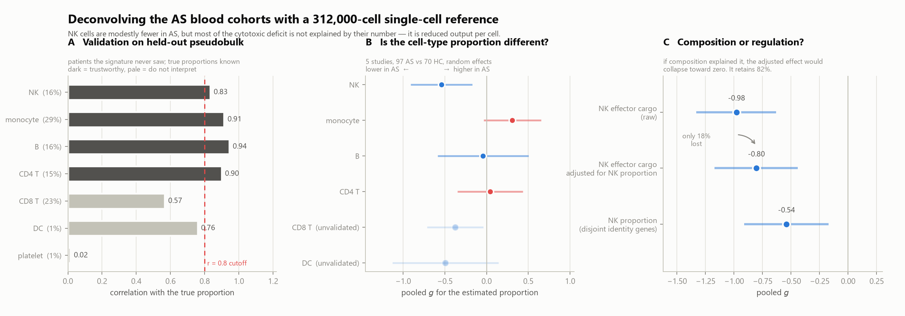

# Ankylosing spondylitis: are NK cells missing, or just quiet?

Independent reanalysis of public AS transcriptomics, done from scratch. Written by a patient learning the methods, so the wrong turns are documented alongside the results.

AS blood has a weaker NK-cell gene signature than healthy blood. That has been published several times. What nobody had separated is **why**: are there fewer NK cells, or are the same NK cells making less?

Those mean different things. Fewer cells is a trafficking or survival problem. Quieter cells is a functional one.

## What we found

Five independent cohorts, **97 AS patients vs 70 healthy controls**, each study analysed separately and combined by random-effects meta-analysis. Then deconvolved against a 312,000-cell single-cell reference to split proportion from per-cell expression.

| | pooled effect (*g*) | 95% CI |
|---|---|---|
| NK cytotoxic cargo (granzymes, perforin, granulysin) | **−0.98** | −1.33 to −0.63 |
| ...after accounting for how many NK cells are present | **−0.80** | −1.17 to −0.44 |
| NK cell proportion | −0.54 | −0.91 to −0.17 |

**82% of the cytotoxic deficit survives adjusting for cell number.** NK cells in AS blood have turned down their weapons. There are also somewhat fewer of them, but that is the smaller effect.



Independent support, from a method that cannot be fooled the same way: a [meta-analysis of 95 flow-cytometry studies](https://www.ncbi.nlm.nih.gov/pmc/articles/PMC8291033/) covering **4,020 patients and 3,065 controls** found **no difference in NK cell percentage** at all. Flow cytometry counts cells by surface protein and is blind to how much a cell is transcribing. Our method infers cell counts from transcripts and so mistakes a quiet cell for an absent one.

The two have opposite blind spots and point the same way. If the flow data is right, the true composition shift is near zero and essentially all of it is regulation.

## How we avoided fooling ourselves

The obvious version of this analysis is circular. Deconvolution reads cell proportions out of the same transcripts as the expression signature, so "adjust the NK signature for the NK proportion" removes the signal by construction and would return "it's all composition" no matter what is true.

So the two numbers use **disjoint gene sets**. Proportion comes only from NK *identity* genes (receptors, lineage transcription factors), with every effector gene deleted from the signature matrix first. The outcome is the *effector* genes, untouched.

Count the soldiers by their uniforms, then ask how much ammunition they carry. Count them by their ammunition and you can never tell a smaller army from a worse-supplied one.

Other checks that changed the answer:

- **Validate before interpreting.** Deconvolution always returns a confident number. We tested it on held-out pseudobulk from 13 patients the reference never saw, where the truth is known. NK recovered at *r* = 0.83. **CD8 T failed at 0.57** and was discarded, despite a nominally significant result (*p* = 0.029), because cytotoxic T cells share GNLY, NKG7 and PRF1 with NK cells.
- **Check the background.** The genome-wide median effect is −0.13, not zero. Against a 50/50 null every downward gene set looks significant.
- **Two normalisation bugs found by diagnostics, not by FDR.** Raw counts used without depth normalisation in one cohort (library size tracked disease status, so every gene inherited the shift), and a supervised batch correction already baked into another cohort's GEO matrix.
- **An unexplained compartment.** 30–59% of each real bulk sample lands in a sink of rare reference types, and the sink is slightly larger in AS, which could manufacture the whole result. Renormalising moves NK from −0.54 to −0.49. Not the explanation.

## Also in there

Platelet and integrin genes are the strongest *upward* signal: 10 of 11 canonical markers up, mean *g* = +0.44 (ITGA2B +0.83, *q* = 0.001). A [2025 deep plasma proteomics study](https://pmc.ncbi.nlm.nih.gov/articles/PMC12957791/) of 104 samples independently landed on integrin-pathway proteins as its top AS biomarkers. Different molecules, different compartment, same pathway. We have not followed this up.

**AIF1 is a clean null** (*g* = +0.28, CI −0.18 to +0.74) at 80% power for *g* = 0.44. Not a failed replication: AIF1 was established as a TNF-inhibitor *response* marker, a within-disease contrast this data cannot address.

## What this is not

A diagnostic. The NK score reaches AUC 0.77 against healthy controls. In a back-pain clinic, a positive result means a **17.7% chance of AS** — 4.6 false alarms per true case. CRP manages 15.6% and HLA-B27 manages 37.2%. All three are rule-out tests, not rule-in.

And every control here is a healthy volunteer. The comparison that matters clinically is AS versus mechanical back pain, and no public dataset we could find has it.

## Reports

| | |
|---|---|
| [BULK_META.md](BULK_META.md) | The meta-analysis and the deconvolution: datasets, methods, every caveat. |
| [REPORT.md](REPORT.md) | Earlier single-cell work — reanalysis of GSE277117 (Song et al., *Nat Commun* 16:5531, 2025), TNF-inhibitor response in 25 patients. |
| [NEXT_STEPS.md](NEXT_STEPS.md) | Project plan and the running list of traps. |

## Running it

```bash
python -m venv .venv && .venv/Scripts/pip install -r requirements.txt
```

The bulk meta-analysis runs locally in minutes. The single-cell reference needs [Modal](https://modal.com) — the object wants 64 GiB. Every script re-fetches its own data from GEO; nothing raw is committed.
