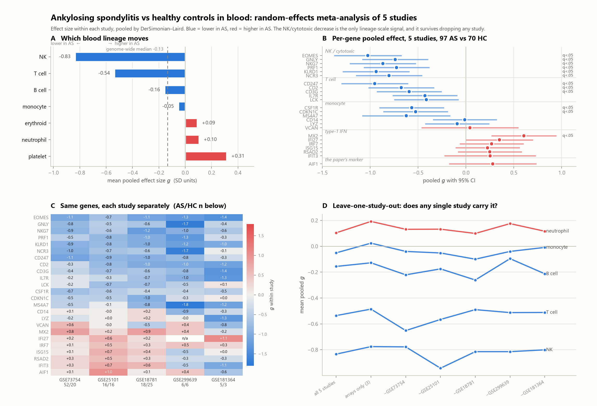
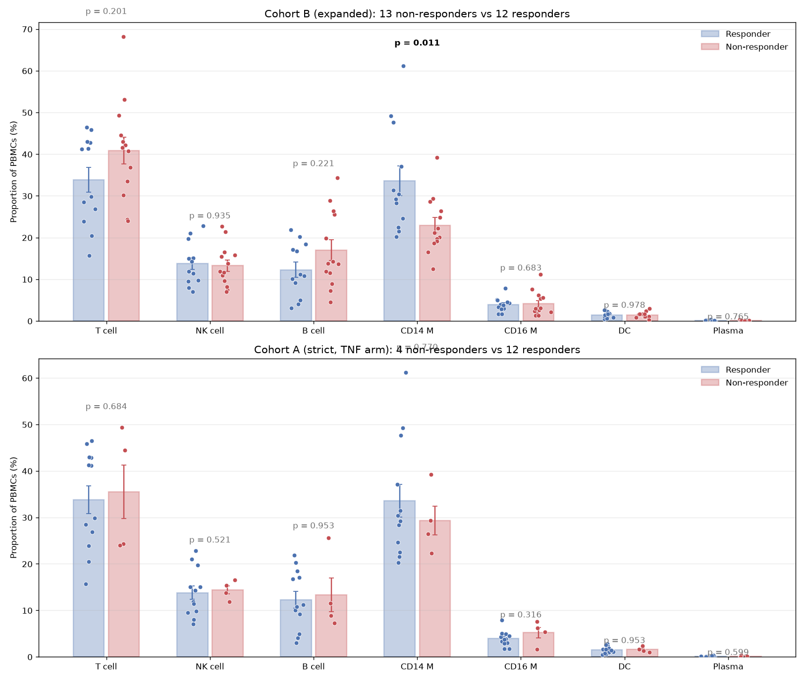

# Ankylosing spondylitis transcriptomics

Independent reanalyses of public AS data, done from scratch rather than by rerunning the authors' pipelines. Written by a patient learning the methods, so the mistakes are documented alongside the results.

| | |
|---|---|
| **[REPORT.md](REPORT.md)** | **Single cell — TNF-inhibitor response.** Reanalysis of GSE277117 (Song et al., *Nat Commun* 16:5531, 2025). 314k cells, 25 AS patients. Two of the paper's claims replicate cleanly; the rest are underpowered at *n* = 25. Three technical traps that each produced a confident wrong answer. |
| **[BULK_META.md](BULK_META.md)** | **Bulk — AS vs healthy controls.** Random-effects meta-analysis of 5 independent cohorts, 97 AS vs 70 HC. A reproducible NK/cytotoxic decrease, a weak but specific type-1 interferon elevation, and a clean null for AIF1. |
| **[NEXT_STEPS.md](NEXT_STEPS.md)** | Project plan and the running checklist of traps. |

## Headline figures





## Layout

```
scripts/     analysis code — single-cell pipeline (Modal) and bulk meta-analysis (local)
data/        derived tables; raw downloads are gitignored
figures/     generated figures
```

## Setup

```bash
python -m venv .venv && .venv/Scripts/pip install -r requirements.txt
```

The single-cell pipeline needs [Modal](https://modal.com) (the objects want 32–64 GiB). The bulk meta-analysis runs locally in a few minutes.

## Data

All public, from NCBI GEO. Raw downloads are excluded from the repository; every script re-fetches what it needs.
